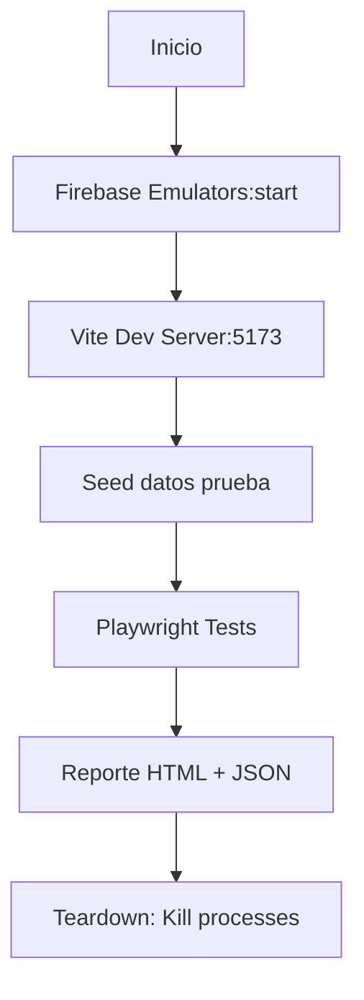

# SDD — Plan de Pruebas QA Visual Automatizado

**Versión:** 1.0  
**Fecha:** 2026-10-11  
**Proyecto:** Control de Bodega v1.4 (EXEPA Logística)  
**Alcance:** Pruebas visuales automatizadas end-to-end de todas las pantallas y flujos críticos

---

## 1. Objetivo y Estrategia

### 1.1 Objetivo

Validar automáticamente el recorrido completo de todas las pantallas del sistema, detectando errores lógicos, de arquitectura y de código sin intervención manual.

### 1.2 Estrategia: Híbrida Automatizada

> **"Automatizar lo repetible, validar lo exploratorio mediante aserciones"**

| Capa                 | Herramienta                           | Qué Valida                                    |
| -------------------- | ------------------------------------- | --------------------------------------------- |
| **Infraestructura**  | Firebase Emulators + Vite Dev Server  | Entorno aislado, sin tocar producción         |
| **E2E Flujos**       | Playwright (Chromium)                 | Recorrido visual completo por feature flags   |
| **Contratos**        | Vitest + @firebase/rules-unit-testing | Reglas Firestore, idempotencia, colas offline |
| **Tipos/Contratos**  | TypeScript + Zod                      | Contratos OCR, mappers, DTOs                  |
| **Regresión Visual** | Playwright Screenshots                | Diff automático vs baseline                   |

### 1.3 Principios

- **Cero manual**: Todo scriptable, repetible en CI
- **Determinista**: Misma semilla, mismos datos, mismo resultado
- **Aislado**: Emuladores locales, sin dependencias externas
- **Rápido**: < 5 min suite completa, paralelo donde sea seguro

---

## 2. Arquitectura de Pruebas

### 2.1 Estructura de Directorios

```
tests/
├── e2e/
│   ├── playwright.config.ts          # Config global + globalSetup/Teardown
│   ├── fixtures/
│   │   ├── auth-user.json            # Estado autenticado (localStorage)
│   │   ├── sample-oc.pdf             # PDF orden de compra prueba
│   │   ├── sample-invoice.pdf        # Factura para OCR
│   │   └── feature-flags.json        # Combos de flags
│   ├── utils/
│   │   ├── test-utils.ts             # Helpers comunes (selectores, waits, assertions)
│   │   ├── page-objects.ts           # Page Objects por pantalla
│   │   └── test-utils.ts             # Generadores de datos, mocks
│   └── flows/
│       ├── 01-recepcion-con-oc.spec.ts
│       ├── 02-recepcion-sin-oc.spec.ts
│       ├── 03-programacion-ocr.spec.ts
│       ├── 04-embarques.spec.ts
│       ├── 05-configuracion.spec.ts
│       └── 06-feature-flags-matrix.spec.ts
├── unit.test.ts                      # Lógica offline queue, tipos, utils
├── offlineQueuePath.test.ts          # Resolución paths {orgId}
├── receptionSubmission.test.ts       # Idempotencia ReceptionSubmission
└── firestore.rules.emulator.test.ts  # Reglas Firestore (14 tests)
```

### 2.2 Flujo de Ejecución (globalSetup)



---

## 3. Matriz de Flujos Críticos

### 3.1 Flujos por Pantalla

| Flujo                | Pantallas                                                                 | Feature Flags                                                      | Callables Backend                                        |
| -------------------- | ------------------------------------------------------------------------- | ------------------------------------------------------------------ | -------------------------------------------------------- |
| **Recepción con OC** | `NuevaRecepcionStep1` → `Step2` → `RecepcionCompletada`                   | `USE_FIRESTORE_RECEPCIONES=true`<br>`USE_FIRESTORE_CATALOGOS=true` | `create_reception`<br>`uploadInvoicePreviewWithMetadata` |
| **Recepción sin OC** | `NuevaRecepcionStep1` (hasOC=false) → `Step2`                             | `USE_FIRESTORE_RECEPCIONES=true`<br>`USE_FIRESTORE_CATALOGOS=true` | `create_reception`                                       |
| **Programación OCR** | `ProgramacionRecepcion` → `MatchProducts` → `OcrResults` → `CompleteStep` | `USE_FIRESTORE_CATALOGOS=true`                                     | `extract_ocr_secure`                                     |
| **Embarques**        | `Embarques` → `Escaneo QR` → `Confirmar`                                  | `USE_FIRESTORE_EMBARQUES=true`                                     | `confirm_shipment`                                       |
| **Inventario/Lotes** | `LotesCaducidades`, `Inventario`                                          | `USE_FIRESTORE_INVENTARIO=true`                                    | `inventoryService`                                       |
| **Configuración**    | `Configuracion` (CRUD almacenes, proveedores, conversiones)               | `USE_FIRESTORE_CATALOGOS=true`                                     | CRUD Firestore directo                                   |

### 3.2 Matriz de Feature Flags (4×4 = 16 combinaciones, 4 críticas)

| Combo                | USE_FIRESTORE_RECEPCIONES | USE_FIRESTORE_CATALOGOS | USE_FIRESTORE_EVIDENCIAS | USE_FIRESTORE_OFFLINE_QUEUE | Escenario                          |
| -------------------- | ------------------------- | ----------------------- | ------------------------ | --------------------------- | ---------------------------------- |
| **Full Firebase**    | ✅                        | ✅                      | ✅                       | ✅                          | Producción                         |
| **Solo Catálogos**   | ❌                        | ✅                      | ❌                       | ❌                          | Catálogos remotos, recepción local |
| **Solo Recepciones** | ✅                        | ❌                      | ✅                       | ❌                          | Recepción remota, catálogos local  |
| **Todo Local**       | ❌                        | ❌                      | ❌                       | ❌                          | Fallback total (offline)           |

---

## 4. Casos de Prueba por Flujo

### 4.1 Flujo 1: Recepción CON OC (`01-recepcion-con-oc.spec.ts`)

| ID             | Caso                            | Pasos                                                                                                                                                                                                     | Validaciones                                                                                                                                                                                                                                      |
| -------------- | ------------------------------- | --------------------------------------------------------------------------------------------------------------------------------------------------------------------------------------------------------- | ------------------------------------------------------------------------------------------------------------------------------------------------------------------------------------------------------------------------------------------------- |
| **REC-OC-001** | Creación completa con OC        | 1. Navegar `/nueva-recepcion`<br>2. Seleccionar "Sí tengo OC"<br>3. Rellenar folio, tarimas, proveedor, logística<br>4. Subir PDF OCR<br>5. Click Continuar<br>6. Verificar navegación a Step2/Completada | ✅ Carga catálogos<br>✅ OCR extrae líneas<br>✅ Match productos (confirmado/sugerido)<br>✅ Tabla conversiones + stickers<br>✅ `create_reception` llamado con `operationId` estable<br>✅ Navegación a pantalla final<br>✅ Sin errores consola |
| **REC-OC-002** | Idempotencia: doble click       | Click rápido 2x en "Continuar"                                                                                                                                                                            | ✅ Una sola recepción creada<br>✅ `operationId` reutilizado<br>✅ Backend devuelve `idempotent: true`                                                                                                                                            |
| **REC-OC-003** | Fallo Storage → retry evidencia | Simular error en `uploadInvoicePreview`                                                                                                                                                                   | ✅ Mensaje "La recepción ya se creó..."<br>✅ Botón "Reintentar evidencia" visible<br>✅ Botón "Continuar sin evidencia" funcional                                                                                                                |
| **REC-OC-004** | Evidencia opcional              | Sin subir archivo, click Continuar                                                                                                                                                                        | ✅ Recepción creada sin evidencia<br>✅ Estado `evidence_not_selected`                                                                                                                                                                            |

### 4.2 Flujo 2: Recepción SIN OC (`02-recepcion-sin-oc.spec.ts`)

| ID              | Caso         | Validaciones                                                                                                                                                 |
| --------------- | ------------ | ------------------------------------------------------------------------------------------------------------------------------------------------------------ |
| **REC-SIN-001** | Sin folio OC | ✅ Toggle "No tengo OC" oculta campo folio<br>✅ Aviso "Sin OC, se registrará sin folio"<br>✅ Recepción creada con `operationId` pero sin `purchaseOrderId` |

### 4.3 Flujo 3: Programación OCR (`03-programacion-ocr.spec.ts`)

| ID          | Caso                         | Validaciones                                                                                                                                                                   |
| ----------- | ---------------------------- | ------------------------------------------------------------------------------------------------------------------------------------------------------------------------------ |
| **OCR-001** | Subida factura → OCR → Match | ✅ Extrae folio, fecha, proveedor, líneas<br>✅ Match productos: confirmado/sugerido/manual<br>✅ Conversiones auto (pz/caja, cajas/tarima)<br>✅ Genera `operationId` y DRAFT |
| **OCR-002** | Flujo completo pasos         | ✅ Match → Conversiones → Completar<br>✅ Navegación sin pérdida de datos                                                                                                      |

### 4.4 Flujo 4: Embarques (`04-embarques.spec.ts`)

| ID          | Caso                         | Validaciones                                                                                                                                                     |
| ----------- | ---------------------------- | ---------------------------------------------------------------------------------------------------------------------------------------------------------------- |
| **EMB-001** | Crear → Escanear → Confirmar | ✅ Lista embarques con estados<br>✅ Crear: producto + almacén + cantidad<br>✅ Escanear QR valida pertenencia<br>✅ `confirm_shipment` hard reserve + inventory |
| **EMB-002** | Bloqueo cross-warehouse      | ✅ Rechaza tarima de otro almacén<br>✅ Error claro en UI                                                                                                        |

### 4.5 Flujo 5: Configuración (`05-configuracion.spec.ts`)

| ID          | Caso              | Validaciones                                                                            |
| ----------- | ----------------- | --------------------------------------------------------------------------------------- |
| **CFG-001** | CRUD Almacenes    | ✅ Crear/Editar/Eliminar con validaciones<br>✅ Persistencia Firestore + fallback local |
| **CFG-002** | CRUD Proveedores  | ✅ Tipos: mercancía / logística                                                         |
| **CFG-003** | CRUD Conversiones | ✅ pz/caja, cajas/tarima por producto                                                   |

### 4.6 Matriz Feature Flags (`06-feature-flags-matrix.spec.ts`)

| Combo                | Validaciones Específicas                                                                        |
| -------------------- | ----------------------------------------------------------------------------------------------- |
| **Full Firebase**    | Catálogos remotos (loading spinner), recepción backend, evidencia Storage, offline queue activa |
| **Solo Catálogos**   | Catálogos remotos, recepción localStorage, sin evidencia, sin queue                             |
| **Solo Recepciones** | Catálogos locales (inmediato), recepción backend, evidencia Storage                             |
| **Todo Local**       | Todo inmediato, localStorage, sin red                                                           |

---

## 5. Validaciones Arquitectónicas Automáticas

### 5.1 Errores Lógicos Detectados

```typescript
// En cada test: assertNoConsoleErrors()
await utils.assertNoConsoleErrors([
  /favicon/, // Ignorar
  /Extension/, // Ignorar extensiones navegador
  /webpack|hot-update/, // Ignorar HMR
]);
```

### 5.2 Errores de Arquitectura (Aserciones en Page Objects)

```typescript
// Hook order: early return antes de hooks
if (catalogosStatus?.loading) return <Loading /> // Debe estar ANTES de useState/useEffect

// Doble fuente de verdad
const useFirestore = isFeatureEnabled('X') && !!db && canQuery
// Verificar que UI refleja flag correctamente

// Race condition offline queue
await page.context().setOffline(true)
// Verificar encolado en localStorage con operationId único
```

### 5.3 Errores de Código (TypeScript + Contratos)

```typescript
// Typecheck en CI
pnpm typecheck --noEmit --skipLibCheck

// Contratos Zod
import { ReceptionDataSchema } from '@/services/firestore/zodSchemas'
const parsed = ReceptionDataSchema.parse(data) // Falla si types drift
```

---

## 6. Datos de Prueba (Fixtures)

### 6.1 Archivos Requeridos

```
tests/e2e/fixtures/
├── auth-user.json              # localStorage con user autenticado
├── sample-oc.pdf               # OC PDF válido (1-2 páginas)
├── sample-invoice.pdf          # Factura con múltiples líneas
├── sample-qr.png               # QR válido para escaneo
└── feature-flags.json          # Config combos
```

### 6.2 Generador de Datos Únicos

```typescript
// tests/e2e/utils/test-utils.ts
export function generateTestData() {
  const ts = Date.now();
  const rand = Math.random().toString(36).substring(7);
  return {
    ocFolio: `OC-QA-${ts}`,
    tarimas: "5",
    proveedor: "Proveedor Norte",
    proveedorLogistico: "Logística Veloz",
    operationId: `OP-QA-${ts}-${rand}`,
  };
}
```

---

## 7. Comandos de Ejecución

### 7.1 Desarrollo Local

```bash
# Terminal 1: Emuladores (mantener abierto)
firebase emulators:start --only firestore,functions,storage,auth --project demo-exepa-rules

# Terminal 2: Frontend
pnpm dev --port 5173

# Terminal 3: Tests
pnpm test:e2e --project=chromium
```

### 7.2 CI/CD (GitHub Actions)

```yaml
# .github/workflows/qa.yml
jobs:
  qa:
    runs-on: ubuntu-latest
    steps:
      - uses: actions/checkout@v4
      - uses: pnpm/action-setup@v4
      - uses: actions/setup-node@v4
        with: { node-version: "20", cache: "pnpm" }
      - run: pnpm install --frozen-lockfile
      - run: pnpm test:e2e --project=chromium
      - uses: actions/upload-artifact@v4
        if: always()
        with:
          name: playwright-report
          path: playwright-report/
```

### 7.3 Suite Completa (Un Comando)

```bash
# Ejecuta todo: emuladores + dev + tests + reporte
pnpm test:qa

# Donde package.json tiene:
# "test:qa": "concurrently -k -s first \"firebase emulators:exec --only firestore,functions,storage,auth --project demo-exepa-rules 'pnpm dev --port 5173'\" \"sleep 10 && pnpm test:e2e\""
```

---

## 8. Reportes y Métricas

### 8.1 Salidas Generadas

| Archivo                        | Contenido                                      |
| ------------------------------ | ---------------------------------------------- |
| `playwright-report/index.html` | Reporte visual con screenshots, traces, videos |
| `test-results/results.json`    | JSON machine-readable para CI                  |
| `test-results/*.png`           | Screenshots en fallos                          |
| `test-results/*.webm`          | Videos en fallos                               |

### 8.2 Métricas de Éxito

| Métrica              | Target                          |
| -------------------- | ------------------------------- |
| **Cobertura flujos** | 100% (6/6 flujos críticos)      |
| **Cobertura flags**  | 4/4 combos críticos             |
| **Tiempo suite**     | < 5 min                         |
| **Flakiness**        | 0% (reintentos = 0 local, 2 CI) |
| **Errores consola**  | 0 en tests pass                 |

---

## 9. Mantenimiento y Evolución

### 9.1 Agregar Nuevo Flujo

1. Crear Page Object en `utils/page-objects.ts`
2. Crear spec en `flows/XX-nuevo-flujo.spec.ts`
3. Agregar a matriz flags si aplica
4. Ejecutar `pnpm test:e2e --project=chromium --grep "nuevo-flujo"`

### 9.2 Actualizar Selectores

- Usar `data-testid` en componentes React
- Page Objects centralizan selectores (cambio en 1 lugar)

### 9.3 Seed de Datos

```typescript
// scripts/seed-qa-data.ts
// Poblar emulador con: org, almacenes, proveedores, productos, usuario demo
```

---

## 10. Checklist de Validación Pre-Deploy

- [ ] `pnpm typecheck` pasa
- [ ] `pnpm lint` pasa
- [ ] `pnpm test:run --config vitest.rules.config.ts` (14 tests) pasa
- [ ] `pnpm test:run` (unit + contratos) pasa
- [ ] `pnpm test:e2e` (6 flujos × 4 flags = 24 tests) pasa
- [ ] Reporte Playwright sin flakiness
- [ ] 0 errores consola en tests pass
- [ ] Diff visual vs baseline aprobado

---

## 11. Referencias de Código

| Archivo                                           | Descripción                                                                       |
| ------------------------------------------------- | --------------------------------------------------------------------------------- |
| `tests/e2e/playwright.config.ts`                  | Config global + emuladores + dev server                                           |
| `tests/e2e/utils/page-objects.ts`                 | 7 Page Objects (Step1, Step2, Completada, Programacion, Embarques, Config, Login) |
| `tests/e2e/utils/test-utils.ts`                   | Helpers: waits, selects, uploads, offline, assertions                             |
| `tests/e2e/flows/01-recepcion-con-oc.spec.ts`     | Flujo principal con idempotencia                                                  |
| `tests/e2e/flows/06-feature-flags-matrix.spec.ts` | 4 combos × validaciones específicas                                               |

---

_Documento generado automáticamente desde la especificación de estrategia QA. Mantener sincronizado con implementación real._
