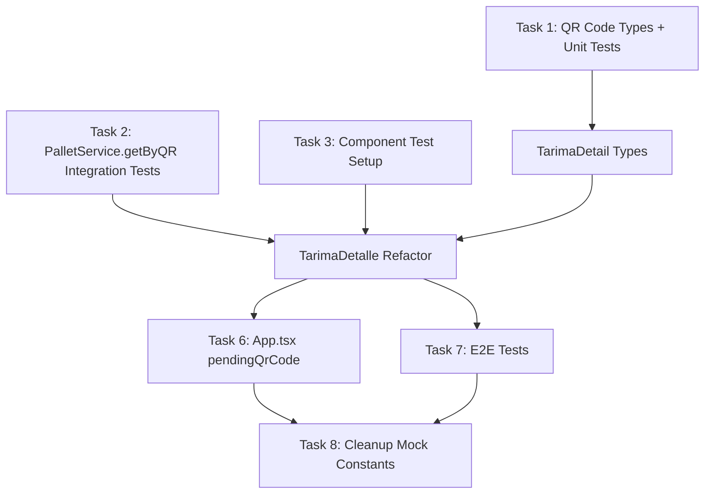

# SDD Tasks: Caso 2 - Complete TarimaDetalle to Read Real Tarima Data from Firestore by QR Code

## Overview

| Field              | Value                                          |
| ------------------ | ---------------------------------------------- |
| **Change ID**      | `tarima-detalle-qr`                            |
| **Project**        | `exepa-logistica` (Control de Bodega v1.4)     |
| **Spec**           | `openspec/changes/tarima-detalle-qr/spec.md`   |
| **Design**         | `openspec/changes/tarima-detalle-qr/design.md` |
| **TDD Mode**       | Strict (`pnpm test:run`)                       |
| **Artifact Store** | Engram + OpenSpec                              |

---

## Task Dependency Graph



---

## Task List

### Phase 1: Foundation (Types + Service Tests) — **Sequential**

| ID       | Task                                                                                                  | Type | Depends On | Spec AC      | Design §   | Effort |
| -------- | ----------------------------------------------------------------------------------------------------- | ---- | ---------- | ------------ | ---------- | ------ |
| **T-01** | Create `src/types/qrcode.ts` with `TarimaQRCode`, `parseTarimaQR`, `isValidTarimaQR`, `buildTarimaQR` | Impl | —          | AC-01, AC-02 | §2.1, §9.1 | 30 min |
| **T-02** | Write unit tests `src/test/types/qrcode.test.ts` (TDD FIRST)                                          | Test | T-01       | AC-01, AC-02 | §6.1       | 20 min |
| **T-03** | Write integration test `src/test/services/palletService.getByQR.test.ts` against emulator (TDD FIRST) | Test | —          | AC-03, AC-04 | §3.1, §6.1 | 30 min |
| **T-04** | Create `src/types/tarimaDetail.ts` with `TarimaDetailView`, `TarimaDetailState`                       | Impl | T-01       | AC-05, AC-06 | §2.1, §9.4 | 20 min |

### Phase 2: Component Refactor (TarimaDetalle) — **Sequential**

| ID       | Task                                                                                                                 | Type | Depends On       | Spec AC                                  | Design §       | Effort |
| -------- | -------------------------------------------------------------------------------------------------------------------- | ---- | ---------------- | ---------------------------------------- | -------------- | ------ |
| **T-05** | Write component tests `src/test/components/TarimaDetalle.qr.test.tsx` (TDD FIRST) — mock services, test all 4 states | Test | T-02, T-03, T-04 | AC-05, AC-06, AC-07, AC-08, AC-09, AC-10 | §4.2, §6.2     | 45 min |
| **T-06** | Refactor `src/screens/TarimaDetalle.tsx` — accept `qrCode` prop, implement state machine, fetch + join logic         | Impl | T-04, T-05       | AC-05, AC-06, AC-07, AC-08, AC-09, AC-10 | §4.2, §9.5     | 60 min |
| **T-07** | Add `pendingQrCode` state to `src/App.tsx` + pass to TarimaDetalle route                                             | Impl | T-06             | AC-04, AC-11                             | §4.1, §5, §9.7 | 20 min |

### Phase 3: E2E + Integration — **Parallelizable**

| ID       | Task                                                                      | Type   | Depends On       | Spec AC             | Design §   | Effort |
| -------- | ------------------------------------------------------------------------- | ------ | ---------------- | ------------------- | ---------- | ------ |
| **T-08** | Write Playwright E2E test `src/test/e2e/tarimaQRFlow.test.ts` (TDD FIRST) | Test   | T-03             | AC-04, AC-11, AC-12 | §6.4, §9.8 | 45 min |
| **T-09** | Run full emulator test suite: `./scripts/emulator-dev.sh test`            | Verify | T-06, T-07, T-08 | All ACs             | —          | 30 min |

### Phase 4: Cleanup — **Sequential**

| ID       | Task                                                                                  | Type    | Depends On | Spec AC | Design §  | Effort |
| -------- | ------------------------------------------------------------------------------------- | ------- | ---------- | ------- | --------- | ------ |
| **T-10** | Remove hardcoded `tarimaNum = 3` mock constants from TarimaDetalle                    | Cleanup | T-06       | AC-05   | §9.9      | 10 min |
| **T-11** | Verify composite index `qrIdentifier` in `firestore.indexes.json` + deploy if missing | Config  | T-03       | AC-03   | §3.1, §10 | 15 min |

---

## Detailed Task Definitions

### T-01: Create QR Code Types (`src/types/qrcode.ts`)

**Description:** Define the QR code format contract for tarima identification.

**Implementation:**

```typescript
export type TarimaQRCode = `TQR-${string}-${string}`;

export interface ParsedQR {
  ocNumber: string;
  tarimaIndex: number;
}

export function parseTarimaQR(qr: string): ParsedQR | null {
  const match = qr.match(/^TQR-(.+)-(\d{3})$/);
  if (!match) return null;
  return { ocNumber: match[1], tarimaIndex: parseInt(match[2], 10) };
}

export function isValidTarimaQR(qr: string): qr is TarimaQRCode {
  return /^TQR-[A-Z0-9]+-\d{3}$/.test(qr);
}

export function buildTarimaQR(ocNumber: string, tarimaIndex: number): TarimaQRCode {
  return `TQR-${ocNumber}-${String(tarimaIndex).padStart(3, "0")}`;
}
```

**Acceptance:** TypeScript compiles, exports correct types.

---

### T-02: Unit Tests for QR Parser (`src/test/types/qrcode.test.ts`)

**Description:** TDD-first unit tests for QR code parsing and validation.

**Test Cases:**

| Input                              | Expected                                 |
| ---------------------------------- | ---------------------------------------- |
| `"TQR-24891-003"`                  | `{ ocNumber: "24891", tarimaIndex: 3 }`  |
| `"TQR-ABC123-001"`                 | `{ ocNumber: "ABC123", tarimaIndex: 1 }` |
| `"TQR-24891-3"`                    | `null` (must be 3 digits)                |
| `"QR-24891-003"`                   | `null` (wrong prefix)                    |
| `"TQR-24891"`                      | `null` (missing index)                   |
| `""`                               | `null`                                   |
| `isValidTarimaQR("TQR-24891-003")` | `true`                                   |
| `isValidTarimaQR("invalid")`       | `false`                                  |
| `buildTarimaQR("24891", 3)`        | `"TQR-24891-003"`                        |
| `buildTarimaQR("ABC", 12)`         | `"TQR-ABC-012"`                          |

**Command:** `pnpm test:run src/test/types/qrcode.test.ts`

---

### T-03: Integration Test for PalletService.getByQR (`src/test/services/palletService.getByQR.test.ts`)

**Description:** Test the existing `PalletService.getByQR` against Firestore emulator.

**Setup:**

```typescript
import { initializeTestEnvironment } from '@firebase/rules-unit-testing';
import { createFirestoreServices } from '@/services/firestore';

beforeAll(async () => {
  env = await initializeTestEnvironment({ projectId: 'demo-test' });
  await env.withSecurityRulesDisabled(async (context) => {
    // Seed: org, warehouse, product, supplier, pallet with qrIdentifier
  });
});

test('getByQR returns PalletDoc when QR exists', async () => {
  const { pallets } = createFirestoreServices(env.authenticatedContext('user').firestore(), 'org_exepa_001');
  const result = await pallets.getByQR('TQR-24891-003');
  expect(result).not.toBeNull();
  expect(result?.qrIdentifier).toBe('TQR-24891-003');
});

test('getByQR returns null when QR not found', async () => {
  const { pallets } = createFirestoreServices(...);
  const result = await pallets.getByQR('TQR-NOTEXIST-999');
  expect(result).toBeNull();
});
```

**Command:** `pnpm test:run src/test/services/palletService.getByQR.test.ts`

---

### T-04: Create TarimaDetail Types (`src/types/tarimaDetail.ts`)

**Description:** Define view model and state machine for TarimaDetalle.

**Implementation:**

```typescript
import { PalletDoc } from "@/services/firestore/types";
import { Timestamp } from "firebase/firestore";

export interface TarimaDetailView {
  qrIdentifier: string;
  lot: string;
  expiryDate: Timestamp;
  quantity: number;
  unit: string;
  status: PalletDoc["status"];
  location?: string;
  notes?: string;
  createdAt: Timestamp;
  productName: string;
  productCode: string;
  supplierName: string;
  supplierCode?: string;
  receptionFolio?: string;
  receptionDate?: Timestamp;
}

export type TarimaDetailState =
  | { status: "loading" }
  | { status: "success"; data: TarimaDetailView }
  | { status: "not-found"; qrCode: string }
  | { status: "error"; message: string; retry: () => void };
```

---

### T-05: Component Tests for TarimaDetalle (`src/test/components/TarimaDetalle.qr.test.tsx`)

**Description:** TDD-first component tests with mocked services covering all 4 states.

**Test Scenarios:**

| State       | Mock Setup                                            | Assertions                                              |
| ----------- | ----------------------------------------------------- | ------------------------------------------------------- |
| `loading`   | Service promise never resolves                        | Skeleton cards visible, `aria-busy="true"`              |
| `success`   | `getByQR` → pallet, `getById` ×2 → product + supplier | All fields rendered, joined names shown                 |
| `not-found` | `getByQR` → `null`                                    | "Tarima no encontrada" text, "Volver al escáner" button |
| `error`     | `getByQR` → throws `NetworkError`                     | Toast shows, "Reintentar" button calls retry            |

**Mock Pattern:**

```typescript
vi.mock("@/services/firestore", () => ({
  createFirestoreServices: () => ({
    pallets: { getByQR: vi.fn() },
    products: { getById: vi.fn() },
    suppliers: { getById: vi.fn() },
  }),
}));
```

**Command:** `pnpm test:run src/test/components/TarimaDetalle.qr.test.tsx`

---

### T-06: Refactor TarimaDetalle (`src/screens/TarimaDetalle.tsx`)

**Description:** Replace hardcoded mock with real Firestore fetch + join logic.

**Key Changes:**

1. Accept `qrCode?: string` prop
2. If `qrCode` provided → fetch via `pallets.getByQR` + join product/supplier
3. If no `qrCode` → legacy mode (use `currentReception` + `tarimaActual`)
4. State machine: `loading` → `success` | `not-found` | `error`
5. Loading skeleton, error toast, retry handler
6. Remove `tarimaNum = 3` and all hardcoded mock data

**Pseudocode:**

```typescript
const { pallets, products, suppliers } = useFirestoreServices();

useEffect(() => {
  if (!qrCode) {
    setState(buildFromReception());
    return;
  }
  let cancelled = false;
  setState({ status: "loading" });
  fetchDetail(qrCode)
    .then((data) => !cancelled && setState({ status: "success", data }))
    .catch((err) => {
      if (cancelled) return;
      if (err instanceof NotFoundError) setState({ status: "not-found", qrCode });
      else setState({ status: "error", message: err.message, retry: () => fetchDetail(qrCode) });
    });
  return () => {
    cancelled = true;
  };
}, [qrCode]);

// Render by state.status
```

---

### T-07: App.tsx pendingQrCode State (`src/App.tsx`)

**Description:** Wire navigation from EscanearQR to TarimaDetalle with QR code passthrough.

**Changes:**

```typescript
const [pendingQrCode, setPendingQrCode] = useState<string | null>(null);

const handleQRFound = useCallback((qr: string) => {
  setPendingQrCode(qr);
  navigate('/tarima-detalle');
}, [navigate]);

const clearPendingQrCode = useCallback(() => setPendingQrCode(null), []);

// In routes:
<TarimaDetalle
  qrCode={pendingQrCode}
  onBack={clearPendingQrCode}
/>
```

---

### T-08: Playwright E2E Test (`src/test/e2e/tarimaQRFlow.test.ts`)

**Description:** Full flow: scan QR → navigate → verify detail view.

**Test Steps:**

```typescript
test("QR scan → TarimaDetalle shows real data", async ({ page }) => {
  await page.goto("/");
  await page.click('[data-testid="btn-escanear-qr"]');

  // Mock camera / manual input
  await page.fill('[data-testid="qr-input"]', "TQR-24891-003");
  await page.click('[data-testid="qr-submit"]');

  // Verify navigation
  await expect(page).toHaveURL(/\/tarima-detalle/);

  // Verify detail renders
  await expect(page.locator('[data-testid="product-name"]')).toHaveText("Manzana Gala");
  await expect(page.locator('[data-testid="lot"]')).toHaveText("LOTE-2024-001");
  await expect(page.locator('[data-testid="expiry"]')).toBeVisible();
});
```

**Command:** `pnpm test:e2e src/test/e2e/tarimaQRFlow.test.ts`

---

### T-09: Full Emulator Test Suite (`./scripts/emulator-dev.sh test`)

**Description:** Run complete test suite against emulator to verify all ACs.

**Expected:** All unit, component, integration, and E2E tests pass. No regressions in existing tests.

---

### T-10: Cleanup Mock Constants

**Description:** Remove `tarimaNum = 3`, hardcoded product data, mock arrays from TarimaDetalle.

**Files:** `src/screens/TarimaDetalle.tsx` — delete lines with hardcoded mock.

---

### T-11: Verify/Deploy Composite Index

**Description:** Ensure `firestore.indexes.json` has the required index for `pallets` collection group query on `qrIdentifier`.

**Index:**

```json
{
  "collectionGroup": "pallets",
  "fields": [{ "fieldPath": "qrIdentifier", "order": "ASCENDING" }],
  "queryScope": "COLLECTION_GROUP"
}
```

**Deploy:** `firebase deploy --only firestore:indexes`

---

## Execution Order (Automatic Mode)

```
T-01 → T-02 → T-03 → T-04 → T-05 → T-06 → T-07 → (T-08 || T-11) → T-09 → T-10
```

**Gatekeeper Checkpoints:**

- After T-02: Unit tests pass
- After T-03: Integration test passes
- After T-05: Component tests pass
- After T-06: TarimaDetalle renders without errors
- After T-09: Full suite passes (ALL ACs verified)

---

## Risk Register

| Task | Risk                  | Mitigation                     |
| ---- | --------------------- | ------------------------------ |
| T-03 | Emulator flaky        | Retry logic, isolated test env |
| T-06 | Join missing supplier | Fallback to IDs, log warning   |
| T-08 | Playwright brittle    | Stable data-testid attributes  |
| T-11 | Index deploy delay    | Deploy early, verify in T-03   |

---

## Total Estimated Effort: ~4.5 hours
